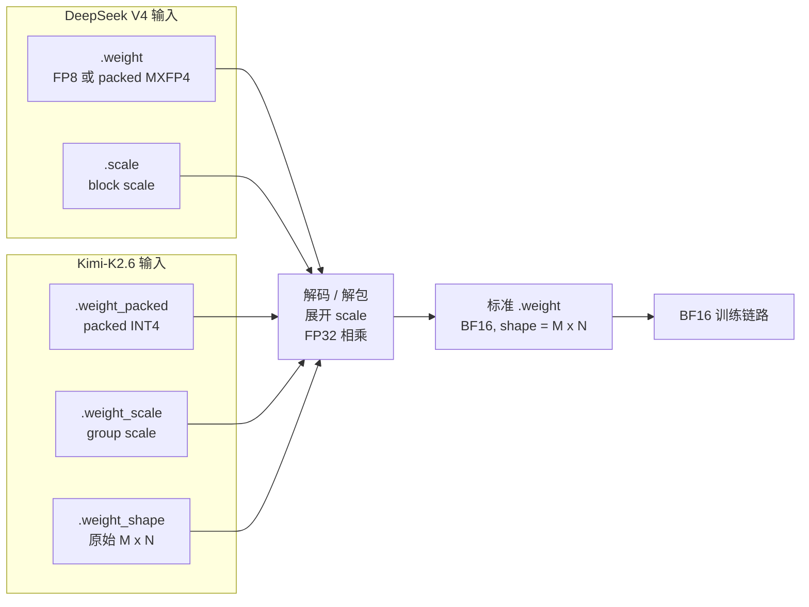
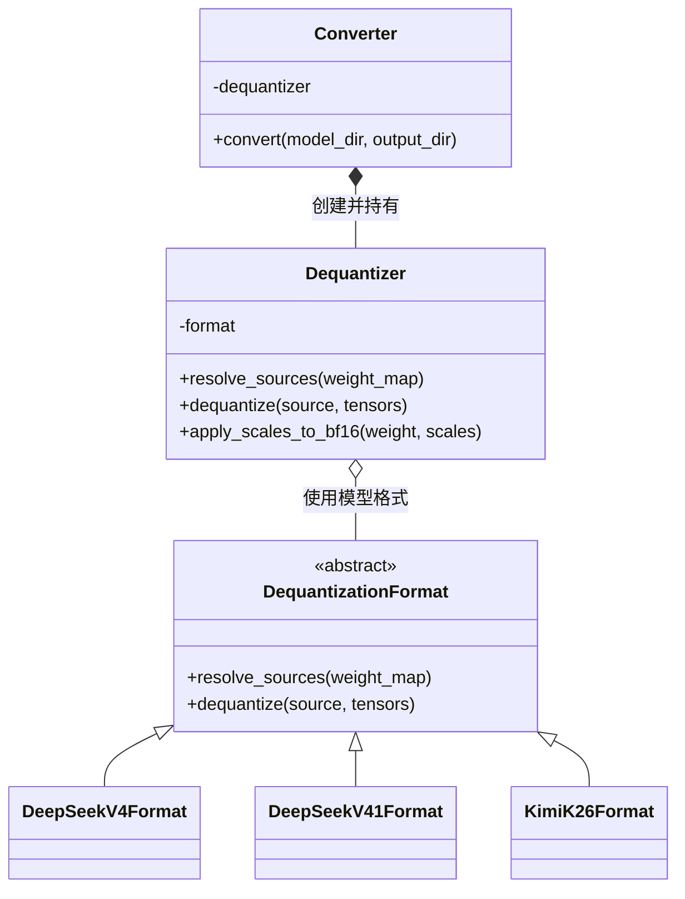
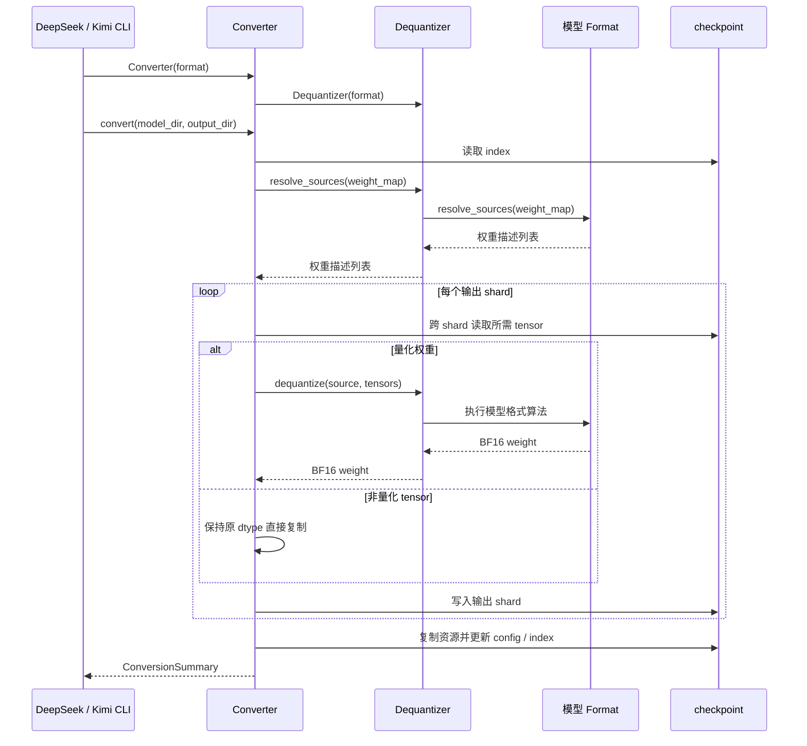

# 量化 checkpoint 转 BF16（离线反量化）

本目录提供 DeepSeek V4、DeepSeek V4.1 Flash 和 Kimi-K2.6 checkpoint 的离线反量化工具。它们根据 FP8、MXFP4、FP4 或 packed INT4 量化值及对应的 scale 等信息生成 BF16 权重，输出可以被当前 BF16 训练链路直接加载的 Hugging Face checkpoint。

## 1. 使用说明

### 1.1 DeepSeek V4：FP8 / MXFP4 转 BF16

```bash
python scripts/dequant/deepseekv4.py \
  --input-fp8-hf-path /path/to/deepseek-v4 \
  --output-hf-path /path/to/deepseek-v4-bf16
```

### 1.2 DeepSeek V4.1 Flash：FP8 / FP4 转 BF16

```bash
python scripts/dequant/deepseekv4_1.py \
  --input-fp8-hf-path /path/to/deepseek-v4.1-flash \
  --output-hf-path /path/to/deepseek-v4.1-flash-bf16
```

### 1.3 Kimi-K2.6：packed INT4 转 BF16

Kimi 的 INT4 解包使用 `compressed-tensors`，需要额外安装：

```bash
pip install compressed-tensors
```

然后执行：

```bash
python scripts/dequant/kimik26.py \
  --model-dir /path/to/kimi-k2.6 \
  --output-dir /path/to/kimi-k2.6-bf16
```

## 2. 反量化原理

### 2.1 量化和反量化分别做什么

模型权重本质上是一张很大的数字表。直接保存这些小数会占用很多空间。量化会把一组小数换成占用空间更小的低精度数字，同时为这组数字保存一个 scale。scale 可以理解为这组数字共用的“单位”：低精度数字乘以它，才能得到接近原权重的数值。

以一组权重为例，量化 checkpoint 保存的是低精度值 `q` 和缩放系数 `s`，而不是原始浮点权重 `W`：

```text
量化后保存：W -> (q, s)
反量化计算：W_dequant = q_decode * s
```

反量化先解码或解包 `q`，再把每个 scale 展开到它负责的权重位置，最后逐元素相乘：

```text
W_bf16 = BF16(FP32(q_decode) * FP32(expand(scale)))
```

### 2.2 为什么量化 checkpoint 不能直接用于当前 BF16 训练

训练代码希望读到的是一张已经展开、可以直接计算的 BF16 权重表，例如 `model.layers.0.mlp.down_proj.weight`。但量化 checkpoint 保存了压缩后的数字，以及还原这些数字所需的信息，训练代码不能直接把这些零散内容当作权重使用。

- DeepSeek V4 的量化权重由 `.weight` 和 `.scale` 共同表达；DeepSeek V4.1 Flash 官方权重由 `.weight` 和 `.weight_scale_inv` 共同表达；
- Kimi 的量化权重由 `.weight_packed`、`.weight_scale` 和 `.weight_shape` 共同表达；
- DeepSeek 的 scale 按 block 或行内 group 管理，Kimi 的 scale 按 group 管理；
- 因此必须先把量化值解码、把各自的 scale 对齐到每个权重，再生成训练代码可以直接加载的 BF16 `.weight`。



### 2.3 我们需要的 BF16 是什么

BF16（Brain Floating Point 16）是一种 16-bit 浮点格式：

| 格式 | 符号位 | 指数位 | 尾数位 | 每个元素 | 特点 |
| --- | ---: | ---: | ---: | ---: | --- |
| FP32 | 1 | 8 | 23 | 4 bytes | 范围和精度都高，但占用更大 |
| BF16 | 1 | 8 | 7 | 2 bytes | 指数范围接近 FP32，适合训练 |
| FP16 | 1 | 5 | 10 | 2 bytes | 尾数更多，但可表示范围小于 BF16 |

BF16 保留了与 FP32 相同宽度的指数位，因此数值范围大，训练时通常比 FP16 更不容易溢出；它只占 2 bytes，又能被当前模型加载、反向传播和优化器流程直接处理。这也是本工具的目标格式。

## 3. 设计实现

公共实现由 `Converter`、`Dequantizer` 和模型 Format 协作完成。下图只表示静态类关系，运行过程见 3.3 的序列图。



### 3.1 类职责与组织关系

- `DequantizationFormat` 是模型格式的抽象基类，规定模型需要提供权重识别和反量化方法（`DeepSeekV4Format`、`DeepSeekV41Format` 和 `KimiK26Format` 分别实现 DeepSeek V4、DeepSeek V4.1 Flash 和 Kimi-K2.6 的格式规则）。
- `Dequantizer` 持有一个具体的模型 Format，并通过它完成单个权重的反量化。
- `Converter` 创建并持有 `Dequantizer`，组织完整的离线 checkpoint 转换。

使用时，模型入口先初始化对应的 Format 实例，再用该实例初始化 `Converter`。`Converter` 内部创建 `Dequantizer` 并将同一个 Format 实例交给它，随后由 `Dequantizer` 完成具体的权重反量化。

### 3.2 模型反量化路径

各模型格式先完成各自的权重解码和 scale 展开，使权重与 scale 的 shape 一致。随后统一调用 `Dequantizer.apply_scales_to_bf16`：将权重和 scale 转为 FP32，完成逐元素乘法，再将结果转为连续的 BF16 tensor。下面只说明各模型格式不同的解码和 scale 展开方式。

#### 3.2.1 DeepSeek V4

1. 在 index 中寻找同名前缀的 `.weight` 和 `.scale`，识别 DeepSeek V4 量化权重。
2. `int8/uint8` 权重按 packed MXFP4 处理，使用 E2M1 查找表解码每个 4-bit 值；1-byte 浮点权重按 FP8 处理。
3. MXFP4 scale 按每 32 列展开，FP8 scale 按 `128 x 128` block 展开。

#### 3.2.2 DeepSeek V4.1 Flash

1. 在 index 中寻找同前缀的 `.weight` 和 `.weight_scale_inv`，并兼容已重命名的 `.scale`；输出继续使用原 `.weight` 名称，`indexer` 等新增子模块也会正常识别。
2. `int8/uint8` 专家权重按 packed FP4 处理，先按低、高 4-bit 顺序拆成 E2M1 数值，再展开每行每 32 列共享的 scale。
3. FP8 权重按 E4M3 解码；根据 scale 的实际 shape 选择 `32 x 32` block、`128 x 128` block 或行内 32 列分组展开。UE8M0 scale 会先还原成 FP32 的 2 的幂，FP32 scale 则直接使用，再与权重相乘并输出 BF16。

#### 3.2.3 Kimi-K2.6

1. 从顶层 `quantization_config` 或 `text_config.quantization_config` 读取 `group_size`。
2. 按 `.weight_packed`、`.weight_scale` 和 `.weight_shape` 收集一个量化权重的三个组件，缺少任一组件都会失败。
3. 使用 `compressed-tensors` 解包 4-bit 权重，并根据 `group_size` 展开 scale。

### 3.3 离线转换流程

DeepSeek V4、DeepSeek V4.1 Flash 和 Kimi-K2.6 的命令行入口最终都通过 `Converter.convert` 执行相同的离线流程：



同一个权重的组件可能位于不同 shard，`Converter` 会根据 index 分别读取。转换时一次只组装一个输出 shard，写完后释放对应 tensor，再处理下一个 shard，避免把整个模型同时放进 CPU 内存。

转换完成后，BF16 权重保存在输出目录中；`ConversionSummary` 只返回反量化 tensor 数、直接复制 tensor 数、输出 shard 数和总字节数，供命令行打印 `[complete]` 信息。
